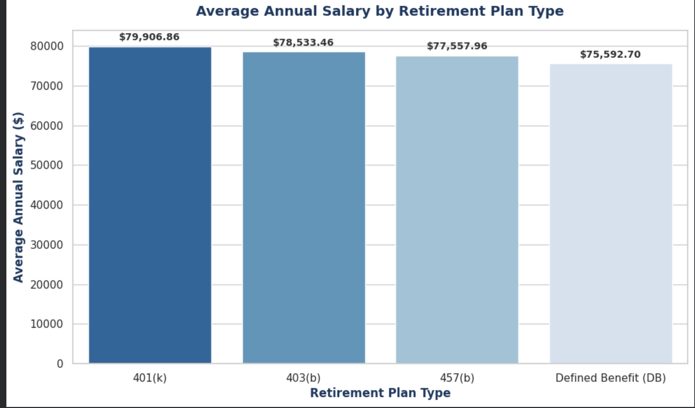
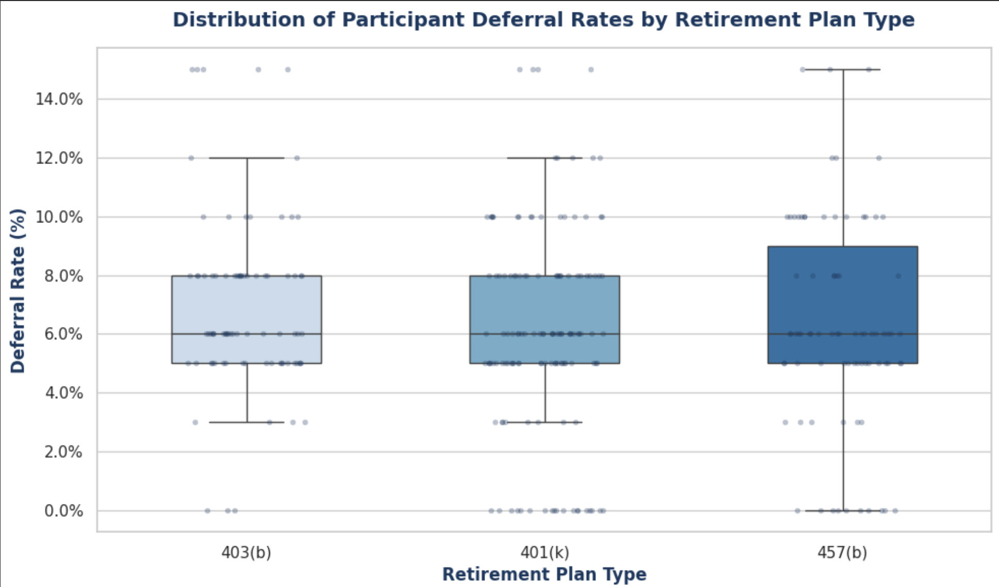
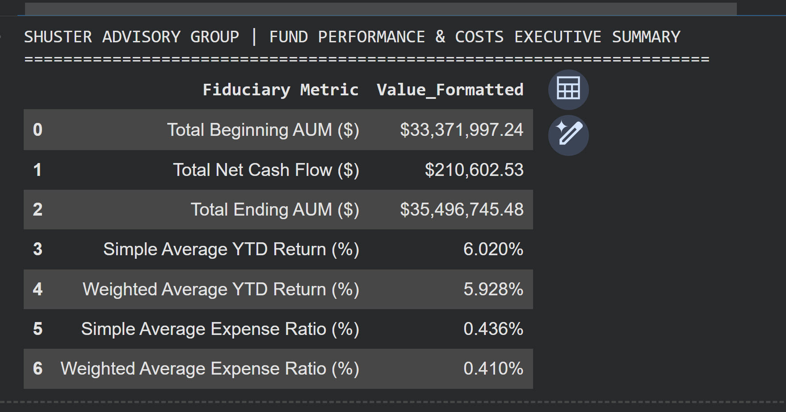

# Retirement Plan Performance & Cost Monitor
## Analytical Methodology & Project Documentation
> **Note on Data Provenance:** All datasets (`Participant_Census.xlsx` and `Fund_Performance_Costs.xlsx`) were programmatically generated and engineered using Python to simulate realistic institutional retirement plan census and fund performance parameters.
You can view the full Python pipeline in the [Jupyter Notebook](HUB_Int'l_Shuster_Retirement_Analytics_Pipeline.ipynb)

> 
### 1. Business Objective
To design an institutional retirement plan review model supporting data integration, participant monitoring, investment performance tracking, and cost efficiency analysis for corporate plan sponsors (simulating operational standards for Shuster Advisory Group).

### 2. Data Engineering & Synthetic Generation Strategy
* **Participant Census (`Participant_Census.xlsx`):** Simulates 350 active employee records across four distinct retirement plan structures: **401(k), 403(b), 457(b), and Defined Benefit (DB) plans**. Attributes include employee identifiers, division mapping, age distribution, annual salaries, deferral percentages, and computed annual contributions.
* **Fund Performance & Costs (`Fund_Performance_Costs.xlsx`):** Simulates a 9-fund institutional lineup spanning large-cap equity, fixed income, target-date retirement funds, and stable value options. Tracks beginning assets under management (AUM), net cash flows, year-to-date returns, ending AUM, and explicit **fund expense ratios** to evaluate plan cost efficiency.

### 3. Analytical Framework & KPI Tracking (`Shuster_Advisory_Group_Retirement_Analytics_Model.xlsx`)
* **Participation Monitoring:** Calculates active participation rates by segmenting contributors from non-contributing participants across plan types using dynamic Excel formulas (`COUNTIF`, `AVERAGEIF`, `SUMIF`).
* **Cost Efficiency Analysis:** Evaluates weighted average expense ratios against institutional benchmark targets to ensure fiduciary compliance and fee transparency.
* **Reporting Architecture:** Multi-tab executive dashboard structured for presentation-ready client reviews and professional portfolio display.

### 4. Visualizations

**Average Annual Salary by Plan Type**

**Distribution of Participant Deferral Rates**

**Fund Performance Costs Executive Summary**

Tools & Technical Stack Used:
* Python & Data Engineering: Python, Pandas, and NumPy for programmatically generating and structuring the synthetic relational datasets (Participant_Census.xlsx and Fund_Performance_Costs.xlsx).

* Advanced Microsoft Excel / OpenPyXL alongside native Excel formula architecture (COUNTIF, AVERAGEIF, SUMIF, SUMPRODUCT) to build the multi-tab executive financial model and dashboard (Shuster_Advisory_Group_Retirement_Analytics_Model.xlsx).

* Microsoft PowerPoint: Structured layout design, dark navy corporate header banners, metric container cards, and typography formatting to produce the executive presentation deck, exported as a professional PDF (Shuster_Advisory_Group_Q3_Client_Review_Presentation.pdf).

* Git & GitHub: Version control, public repository creation (Retirement-Plan-Performance-Monitor), code commits, and Markdown documentation (README.md) for professional portfolio publishing.
